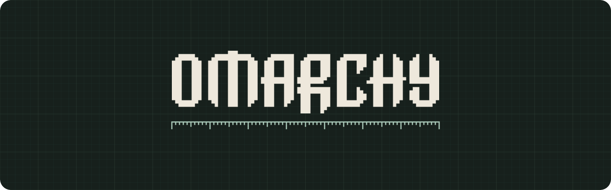
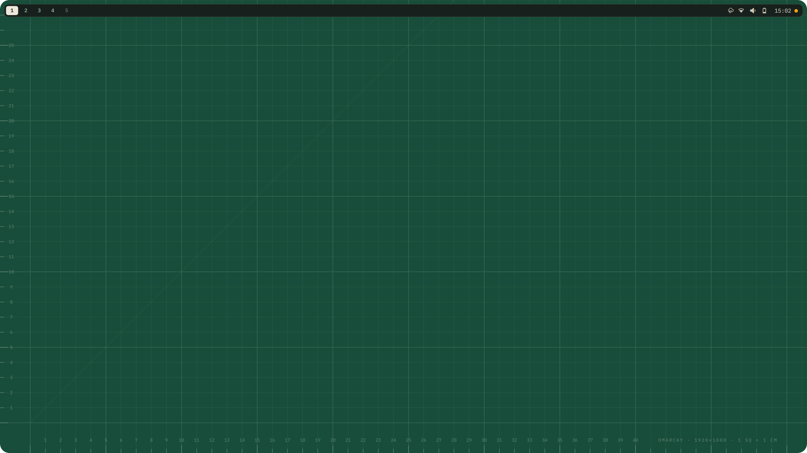
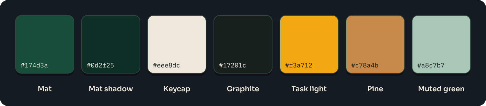
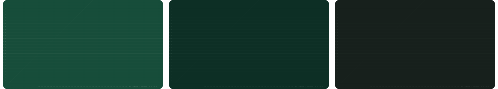
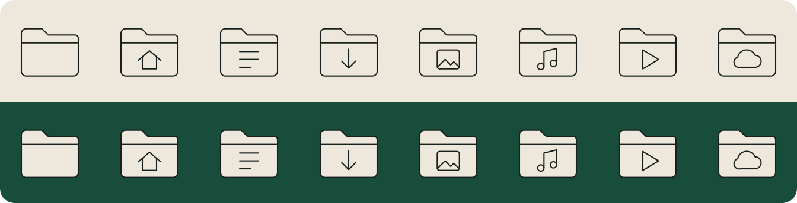
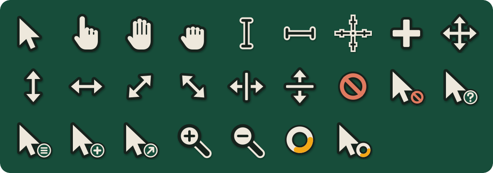
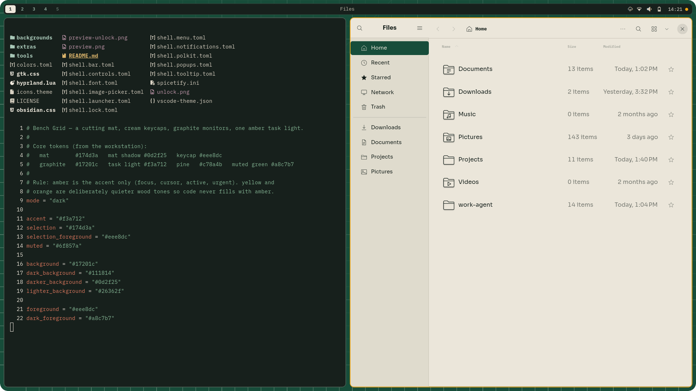
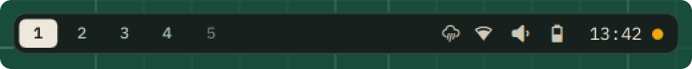

<p align="center">
  
</p>

<h1 align="center">Bench Grid</h1>

<p align="center">
  An Omarchy 4 theme taken from one desk: a forest-green cutting mat, cream keycaps, graphite monitors and a single amber task light.
</p>

```
omarchy theme install https://github.com/hrq-chiuchi/omarchy-bench-grid-theme.git
```

<p align="center">
  
</p>

## Palette

<p align="center">
  
</p>

| Token | Hex | Role |
|---|---|---|
| Mat | `#174d3a` | wallpaper, selection, VS Code status bar |
| Mat shadow | `#0d2f25` | deep surfaces, scrims |
| Keycap | `#eee8dc` | text on dark, light surfaces (Nautilus, tooltips, lock card) |
| Graphite | `#17201c` | terminal, bar, editor |
| Task light | `#f3a712` | **only** focus, cursor, active, changed, urgent |
| Pine | `#c78a4b` | secondary warmth |
| Muted green | `#a8c7b7` | secondary text |

Amber never decorates. Yellow and orange in the ANSI palette are wheat and pine,
so your code doesn't fill up with the accent colour.

## What it themes

Everything except `hyprland.lua` is colour-only and survives `omarchy theme install`. Omarchy strips `*.lua` from
cloned themes, so a clone falls back to Omarchy's generated borders and square corners; copy `hyprland.lua` into
`~/.config/omarchy/themes/bench-grid/` by hand to get the 8px rounding and gaps. `colors.toml` drives the generated
configs; the `shell.*.toml`, `gtk.css`, `spicetify.ini` and VS Code files are hand-tuned with the same hex values,
and `tools/build.sh` regenerates the VS Code theme from the palette.

- **Hyprland**: amber active border, graphite-green inactive border, 8px rounded window corners to match the bar (`hyprland.lua`; `omarchy hyprland corners sharp` turns them off)
- **Omarchy shell** (`shell.*.toml`): bar, launcher, menus, notifications, polkit, lock screen, tooltips
- **Terminals, btop, Neovim, Chromium, Claude**: generated from the palette
- **Obsidian** (`obsidian.css`): a cream page with graphite code blocks inside graphite chrome, like the Typora theme.
  Omarchy copies it into every vault as the **Omarchy** theme; select it once under Settings → Appearance → Themes
- **VS Code** (`vscode-theme.json`): mat status bar, graphite editor, amber kept to focus and changes
- **Wallpapers**: cutting-mat grid with ruler edges (mat, night, graphite)
- **Boot splash and login logo** (`unlock.png`): apply with `omarchy plymouth set by theme bench-grid`

<p align="center">
  
</p>

## Opt-in extras

Omarchy does not wire these by default, so each needs a step from you. The hooks undo their changes when you switch to
another theme.

<p align="center">
  
</p>
<p align="center">
  
</p>

<details>
<summary><b>Rounded corners and gaps (<code>hyprland.lua</code>)</b></summary>

<p align="center">
  
</p>
<p align="center"><sub>8px rounded corners and 8px gaps, lined up with the floating bar. Only the focused window gets the amber border.</sub></p>

`omarchy theme install` strips `*.lua` from cloned themes, so these come from one manual step. Copy `hyprland.lua` from
this repo into `~/.config/omarchy/themes/bench-grid/`, then run `omarchy theme set bench-grid`. To go back to square
corners, run `omarchy hyprland corners sharp`.

</details>

<details>
<summary><b>GTK / Nautilus, Spotify, Starship</b></summary>

- **Cream GTK / Nautilus**: add to `~/.config/gtk-3.0/gtk.css` and `~/.config/gtk-4.0/gtk.css`:
  `@import url("file:///home/<you>/.local/state/omarchy/current/theme/gtk.css");`
- **Spotify** (spicetify): link `~/.config/spicetify/Themes/Omarchy/color.ini` to
  `~/.local/state/omarchy/current/theme/spicetify.ini`, set `current_theme = Omarchy`,
  then run `spicetify refresh` on theme change.
- **Starship**: merge `extras/starship-palettes.toml`, use the named colours
  (`prompt_mark`, `prompt_path`, …), and install the hook:
  `omarchy hook install theme-set extras/hooks/bench-grid-starship.sh`

</details>

<details>
<summary><b>Apps hook: cursor, folder icons, lazygit, fastfetch, Typora, Oh My Pi, eza, fzf, tmux, mpv, Firefox</b></summary>

- **lazygit, fastfetch, Typora, Oh My Pi, eza, fzf, tmux, mpv, Firefox, cursor, folder icons**: `omarchy hook install theme-set extras/hooks/bench-grid-apps.sh`.
  While Bench Grid is active it adds a marked block to lazygit's `config.yml` (skipped if you keep your own `gui:` section)
  and a fastfetch config with a cutting-mat logo. It removes both when you switch themes. It also copies
  `extras/typora/bench-grid.css` into Typora's themes; choose **Bench Grid** once from Typora's Themes menu.
  For Oh My Pi it installs `extras/omp/bench-grid.json` into `~/.omp/agent/themes/` and sets `theme.dark` to it,
  restoring your previous OMP theme when you switch away.
  The cursor is `extras/cursors/BenchGrid` (cream keycap with a graphite edge, amber only on the busy spinner,
  Adwaita for any shape it does not draw). The hook copies it to `~/.local/share/icons/BenchGrid` and makes it
  the default cursor theme through a marked `~/.local/share/icons/default/index.theme`, which it removes when you
  switch away. Apps that are already running keep their old cursor until restarted.
  The folder icons are `extras/icons/Bench-Grid-Icons`: mat-green cutting-mat folders with cream glyphs, inheriting
  Yaru-sage for everything else. The hook copies them to `~/.local/share/icons/` and selects them; without the hook
  you simply get Yaru-sage.
  **eza** gets a marked `~/.config/eza/theme.yml` (sage directories, amber only for modified git state), left alone if
  you already have your own. **tmux** gets a marked block in `~/.config/tmux/tmux.conf` that sources
  `extras/tmux/bench-grid.conf` (mat bar, amber current window and active pane); running servers update live, and
  switching away re-sources your tmux.conf. **fzf** has no config file, so the hook writes its colours to
  `~/.local/state/bench-grid/fzfrc` (emptied on other themes). Point fzf at it once in `~/.bashrc`:
  ```bash
  [[ -f ${XDG_STATE_HOME:-$HOME/.local/state}/bench-grid/fzfrc ]] && export FZF_DEFAULT_OPTS_FILE="${XDG_STATE_HOME:-$HOME/.local/state}/bench-grid/fzfrc"
  ```
  **mpv** gets a marked `mpv.conf` (Sora OSD, cream on a graphite outline, amber for the selected list item) and
  `script-opts/osc.conf` (mat-shadow controller, amber while a button is held); either is skipped if you already
  have your own, and both are removed on other themes. Subtitles are left as they are.
  **Firefox** gets a marked `chrome/userChrome.css` in each default profile (graphite toolbar, mat-green selected tab,
  amber focus ring; the selected tab dims to graphite in unfocused windows) and a marked `user.js` line enabling
  `toolkit.legacyUserProfileCustomizations.stylesheets`. A `userChrome.css` of your own is left alone. Restart
  Firefox to see it; switching themes removes both (the pref itself stays set, which is harmless).
  **bat** needs nothing: Omarchy sets `BAT_THEME=ansi`, which already draws in the theme's terminal colours.

</details>

### Floating bar (experimental)

<p align="center">
  
</p>

<details>
<summary><b>What it is and how to install it</b></summary>

- **Floating bar** (`extras/shell/`): a compact graphite card (26px, 11px text and icons; `shell.font.toml` sets the 11px text for the whole shell) inset 8px from the screen edges so it lines up with the window borders (`inset`; the theme's `hyprland.lua` sets 8px outer and 8px between-window gaps to match the mockup) and 6px above them (`gap`), with 4px of padding on every side (`padding`) and 24×18 numbered workspace
  keycaps with 10px numbers, shaped like the design's (a cream key on the workspace each monitor shows; click it to cycle
  the window layout, as in stock). Omarchy's bar is a full-width strip, so this is a patch on your
  own clone of it: run `extras/shell/install.sh`, then `omarchy restart shell`. *Experimental:* the patches were
  written against Omarchy 4.5.0's shell and may not apply to other versions (the script stops if one fails). The card only appears while the
  theme sets `inset` in `shell.bar.toml`; on other themes the patched bar is the stock strip. To drop the menu
  button, remove `omarchy.menu` from `bar.layout.left` in `~/.config/omarchy/shell.json` (Super+Space still
  opens the menu). After an Omarchy bar update, delete the clones in `~/.config/omarchy/plugins/` (`<user>.bar`, `<user>.tray`,
  `<user>.clock`, `<user>.active-window`) and re-run the script.
  The same script sets up the quieter extras, each switched on from `shell.bar.toml`:
  - **Tray peek** (`tray-peek`): no tray arrow; hovering the right end of the bar slides out the tray drawer. Drag
    the icons you rarely need into it (or list them under `bar.layout.tray` in `shell.json`); they keep their
    tooltips and panels. With tray peek on, the indicators' hover reveal follows the right end too: put
    `omarchy.indicators` beside the tray (not in the drawer) and active ones stay visible while the switched-off
    ones slide out with the drawer.
  - **Muted icons** (`icon-idle`, `icon-hover-brightness`, `icon-hover-saturation`): icons rest in a soft cream and
    light up to the keycap cream under the pointer;
    amber alerts and the clock keep their colour (the script clones the clock for that).
  - **Focused-window title**: put `<user>.active-window` alone in `bar.layout.center` (and `omarchy.system-update`
    in `centerEnd`). It shows the focused program's name (the window title is in its tooltip), and unlike stock, clicking it only
    focuses the window; it never closes it.
  - **Stay-awake dot**: an amber dot instead of the mug. In the right section (e.g. after the clock) it hides when
    off and shows as a ring while the right end is hovered; elsewhere it follows the indicator peek. Entry settings `"slot"` and `"offset"` (px) tuck it
    closer to its neighbour, e.g. `"slot": 10, "offset": -5` after the clock. Add `<user>.stay-awake` to `bar.layout.center` before
    `omarchy.indicators`, and give that entry `"items"` without `StayAwake`. In the tray drawer, give both entries `"alwaysShow": true` so the
    switched-off ones still show there.

</details>

## Fonts

Recommended fonts: IBM Plex Mono (`ttf-ibmplex-mono-nerd`) for the terminal and bar, Sora for the interface.

## Rebuilding

`tools/build.sh [W H]` checks contrast, renders the wallpapers at your resolution, rebuilds the cursors
(`tools/cursor.py`), the folder icons (`tools/icons.py`), the boot logo (`tools/logo.py`) and re-tunes the VS Code theme.
The scripts are only needed to change the design; the built files they produce already ship in the repo.

## License

MIT, see [LICENSE](LICENSE).
